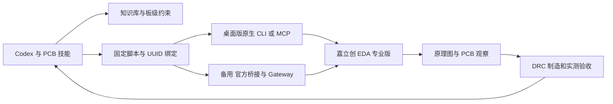

# 接入方案：Codex 技能 + 专业版原生 CLI/MCP + 工程证据

本项目现已有 repo-local Codex 插件包、资料库、`.epro2`解析器和固定action stdio MCP。它可以搜索知识/来源/案例，解析归档，并读取UUID绑定的专业版工程、网表、物理焊盘/层和DRC。0.3增加了本地原生副本的有限几何写入、嘉立创异步自动布线作业和原生导出；不接受任意JavaScript，也不切换用户原会话。原理图/PCB等价比较和真实板验收仍是后续阶段。详见[有限绘板](drawing.md)。

仓库根目录的 `.agents/plugins/marketplace.json` 指向此地的 `.codex-plugin/plugin.json`，该 manifest 引用项目技能和 `.mcp.json`。MCP server 位于 `tools/pcb_mcp.py`，Python 标准库实现。知识与归档入口只读；EDA 入口使用 `tools/eda_client.py` 与固定 `tools/eda_actions/*.js`，并由 session/UUID 绑定和返回 schema 校验约束。`pcb_eda_drc(run=true)` 只触发原生分析，不改设计，但会更新 EDA 的检查状态。`.codex/config.toml` 在此受信任项目启用 repo-local 插件；Codex 需要按客户端实际要求信任项目并刷新会话后才会加载。

MCP暴露知识/归档5个工具、EDA观察/DRC7个工具、副本编辑/原生路由/制造导出12个工具，共24个PCB工具，另有独立Windows-MCP UI控制服务。实时connectivity读取原生网表、物理焊盘和启用铜层；ratline工具返回原生布线完成证据。netlist multiset compare结果和ratline=0意味着EDA中的设计连接已完整布通；完整工程模型和案例笔记留在本机。

## 优先原生 CLI/MCP，网关兼容其他环境

官方 [CLI 文档](https://prodocs.lceda.cn/cn/api/guide/cli.html) 说明 **桌面客户端 V4.1.60+** 已内置 `lceda-pro`，支持 CLI 与 MCP（stdio/HTTP），浏览器版不支持该 CLI。中文版与国际版 `easyeda-pro` 的命令/安装路径不同。接入时先确认实际客户端，再用 `doctor` 和会话信息核实连接，不在研究阶段启动用户编辑器。

CLI 的 `{ok, value, logs, durationMs}` 是调用封装，仍需检查 `value` 的业务结果。`doctor` 即使返回 `ok: true`，也可能 `value.connected: false`。使用 `session list` 得到会话身份，调用时显式 `--session`；不能用进程退出为 0 或命令成功来代替 EDA 在线、目标正确或工程操作成功。既有用户会话不能作为临时测试资源关闭。

旧客户端或网页版可评估官方 Gateway 方案；是否适用先核实版本，不因 CLI 不可用就擅自安装/升级系统软件。原生 MCP 是通信能力，不提供本项目所需的全部工程判断。

嘉立创还维护 [easyeda-api-skill](https://github.com/easyeda/easyeda-api-skill)、[eext-run-api-gateway](https://github.com/easyeda/eext-run-api-gateway) 和 [easyeda-api-sdk](https://github.com/easyeda/easyeda-api-sdk)。它们可作为官方 API 资料与网关备用路线，PCB 项目重点补工程规则、输入模型、计划、变更验证和制造验收。

官方项目的版本、许可和实际脚本路径以本次 [来源登记](../research/eda/sources.json) 为证据，后续固定具体版本。仓库 README、当前类型包、在线文档、用户编辑器可能不一致，不能只选一个版本号推断全部能力。不要把 gateway 的许可证自动套到官方 skill 或第三方工程。

## 先探测，后选择流程

适配器最先返回编辑器、CLI/MCP 或网关、类型版本、目标会话/工程/文档类型、可用方法、单位和层 ID，以及每项能力的 `available / unsupported / unverified` 状态。在线 API 文档不是本地能力证明；函数存在也需验证语义与输出。观察工具检查焦点UUID；绘板流程增加源码前后两次读取及SHA-256基线检查。SDK仍没有全局原子事务，执行期间的同文档外部编辑不能完全隔离。

| 能力 | 文档中已找到的入口 | 必须核实 |
|---|---|---|
| 原理图连接 | `eda.sch_Netlist` | 网表范围、层次网络、引脚映射与当前文档 |
| 原理图更新 PCB | `eda.pcb_Document.importChanges` | Board 对应、UUID、布线残留、不可撤销项；成功后重读连接 |
| 元件/网络/层 | `pcb_PrimitiveComponent`、`pcb_Net`、`pcb_Layer` | 实际查询方法/返回结构、旋转/面、焊盘映射、启用层和单位 |
| 线/过孔 | `pcb_PrimitiveLine`、`pcb_PrimitiveVia` | 连接网络、层跨度、坐标和几何，写后重读 |
| 原生布局/布线 | `pcb_Document` 下的自动任务方法 | 版本、支持规则、异步终态、超时、未布线与 DRC；不能从 `pcb_Tool` 空页推断整个产品无路由能力 |
| 详细 DRC | `eda.pcb_Drc.checkDetailed` | 文档标注的新版本/BETA、执行项、时间与结果完整性 |
| 飞线与命令组 | `pcb_Document.getRatlines` 及命令组方法 | 较新版本才有；命令组不能保证覆盖所有不可撤销操作 |
| 制造文件 | `pcb_ManufactureData` | 确切导出方法/层/参数、完成状态和生成文件检查 |

`DMT_SourcePcb` 的当前文档说明方法是 `NOT_IMPLEMENTED`，不能作为无 GUI 后台 PCB 引擎。`importChanges` 文档备注与已核验签名对 `force` 参数存在矛盾，适配器不能自行添加。最低版本、精确签名和冲突证据见研究结论，不在本页另造一份易漂移的 API 定义。

## 未来的连接与操作契约

CLI/MCP 优先使用只读文档与 API 查询核实实际版本。官方单位表为 SCH=10mil、PCB=mil；本项目若用 mm 为内部规范，需要显式换算并读回验证。API 角度逆时针为正，源文件的 SCH rotation 与 API 方向不同；跨格式时不能直接复制数值，见 [几何契约](../wiki/concepts/units-and-geometry.md)。

官方桥接有 HTTP 执行与 WebSocket 连接面，需先检查健康/编辑器身份，再读取目标；HTTP 在线不能单独证明 EDA 在线或选中了正确工程。连接优先局限本机；执行通道不能接受网页内容拼接出的任意代码。若增加 MCP 接口，暴露有参数校验的工程操作，不默认把原始执行接口当成任意远程命令服务。

当前已实现的抽象操作是 `inspect_project`、`export_connectivity` 和 `inspect_drc` 的固定观察 action；MCP 还提供状态/会话查询。`drawing_state`、`apply_drawing_batch`等固定动作实现平移/导线/通孔，写后验证与恢复状态由`tools/drawing.py`编排。制造导出 action 会重跑DRC、检查零飞线和铜层数，再调用专业版Gerber、BOM及CPL API并验证本地文件。`compare_connectivity`、自动布局和独立避障布线仍未实现。不要把固定 action 的观察结果描述为设计已完成。

每个写请求携带目标文档、基线版本/摘要、操作 ID、单位及参数。执行前拒绝错误文档或基线不匹配；保存副本后进行小批量修改，结束后重新读取并校验。明确哪些操作能被命令组回滚、哪些只能从副本恢复。对未知结果先重读状态，再决定能否重试，避免重复器件或重复走线。

## 异步与验证

自动任务返回句柄/已提交不等于完成。保存任务 ID，观察终态和日志，再读取 PCB 差异、未布线、网络与 DRC。详细 DRC 的 `notChecked/checking/incomplete` 不算通过；只读最近 DRC 结果不算本次执行。所有证据绑定同一目标版本。

如果用户安装版本缺少详细检查或某个 API，输出实际不支持项和可操作的 GUI 检查路径，记录人工检查证据；不能用空列表、默认 true 或文档示例伪造通过。DRC 的 timestamp 单位/分辨率尚未在真实板调用中核实；时间无法严格区分时按不通过处理。

## 为什么暂不另造一套 PCB 引擎

KiCad、Freerouting、tscircuit 等有研究价值，但格式、规则和往返保真度不同。第一阶段使用专业版原生工程与官方接入方式，减少不必要的转换。若以后引入外部路由器，独立验证 DSN/SES 或其他交换文件的网络、焊盘、层、规则和单位，见 [硬件/工具研究](../research/cases/findings.md)。

实现顺序和验收门槛见 [路线](roadmap.md)。
